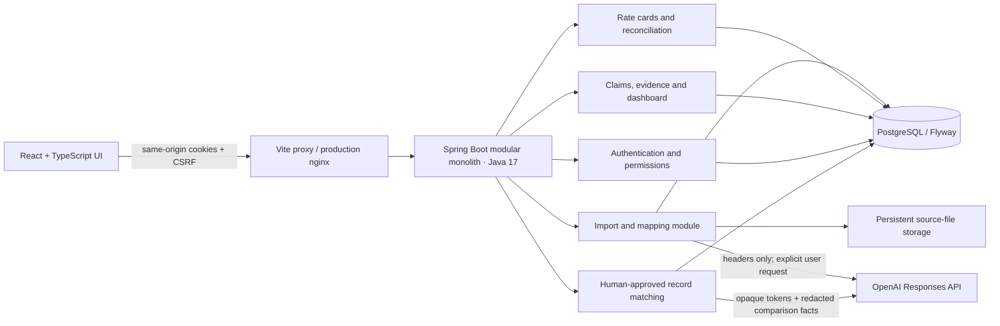
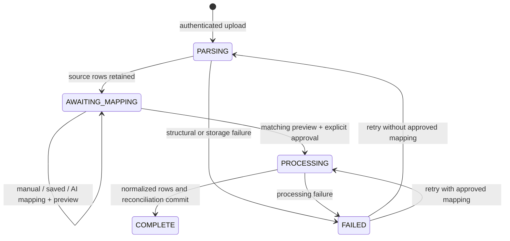

# Reconflow — Technical Design Document

Version: implementation and validation source, 4 November 2026. This Markdown file is the editable technical design source.

## 1. Problem and outcome

A D2C brand receives separate order, settlement, COD, freight and warehouse reports. Reconflow turns approved column mappings into a partner-scoped ledger, applies deterministic commercial rules, identifies actionable discrepancies and prepares claims with reproducible evidence.

The core journey is sign in → upload → preview and approve mappings → reconcile → inspect exceptions → create/update a claim → review money at risk. The application stores real figures in PostgreSQL and uses synthetic demonstration data. External claim submission is deliberately mocked.

## 2. Architecture

The backend is one deployment with separate API/service responsibilities. It does not use microservices, a message broker, a vector database or an AI financial calculator. Transaction boundaries remain inside PostgreSQL, which makes import identity, money arithmetic and claim uniqueness directly enforceable.

| Module / source | Responsibility |
| --- | --- |
| Security / AuthController | Database-backed demo users, BCrypt, sessions, CSRF, roles and health/runtime probes. |
| ReportParser / ImportService / Imports | File identity, streaming parsing, raw rows, validation, mapping versions, progress, approvals and retries. |
| AiProvider / AiMapping / AiMatching | Bounded provider transport, headers-only mapping, redacted match proposals, schema/semantic validation and explicit manual fallback. |
| RateCards | Versioned inclusive commercial periods, replacement and overlap rejection. |
| Reconciliation / ReconcileService / reconcile.sql | BigDecimal reference domain rules, set-based NUMERIC calculations, materialized results and exceptions. |
| Orders | Paginated inspection, dashboard totals, raw evidence and approved same-partner manual matching. |
| Claims | Claim transitions, immutable creation snapshot, notes/audit history and evidence download. |
| Support / Errors | Prepared JDBC helpers, JSON serialization, audit recording and API error responses. |

The existing single Java package keeps the take-home small. Boundaries are expressed by services/controllers, not independently deployed modules. A larger implementation should promote these boundaries to explicit domain packages and narrow DTO/repository interfaces.

## 3. Storage model and migrations

Flyway owns schema changes. The old schema.sql is retained as historical foundation source; automatic execution is disabled with spring.sql.init.mode=never. V1 preserves an existing demo_order table and migrates its values into the normalized workspace. Baseline version 0 supports the pre-Flyway foundation database.

| Table | Identity and retained information |
| --- | --- |
| user_account | Username primary key; BCrypt password hash; FINANCE or FOUNDER role. |
| import_batch | UUID; partner/type/byte hash uniqueness; filename/path, lifecycle, counters, approved mapping and timestamps. |
| source_row | (import_id, row_number); raw JSON values and validated canonical data. |
| row_error | Source import/row and rejection message. Raw evidence is retained. |
| mapping_version | Partner/type mapping JSON, approving actor, predecessor and creation time. IDs are immutable versions. |
| rate_card | Partner, CHANNEL/COURIER kind, inclusive dates, NUMERIC fees/commission, settlement delay and creator. |
| order_record | Unique (partner, external_id); value, payment/delivery, order/due/return dates, source row and seed-only expected override. |
| movement | Unique (partner, transaction_id); kind, optional order ID, signed amount, taxes, event date and source row. |
| reconciliation_entry | One row per order; expected/received/gap/risk, status, tax totals, breakdown, rate IDs and as-of date. |
| exception | One row per (order, type); current amount, active flag and opened/due date. |
| claim | Exception reference, workflow status, current note, immutable creation snapshot and actor/timestamps. |
| audit_event | Actor, action, entity, details JSON and timestamp. |
| match_suggestion | UUID; movement/order, confidence/reason, model/provider, creating account, timestamp and PENDING/APPROVED/SUPERSEDED state. |

Important indexes include order/transaction uniqueness, movement partner/order lookup, mapping history, import history, source-row pagination, error lookup, exception activity, claim uniqueness and import-to-affected-order lookup. V2 persists the exact previewed mapping and actor. V3 indexes import IDs for incremental reconciliation. V4 persists account-bound match proposals and indexes reconciliation dates.

Database NUMERIC(14,2) holds monetary values. Imported values allow at most 12 integer digits and two fractional digits. Commission uses NUMERIC(7,4). JSON preserves source text and calculation metadata; it is not a substitute for the indexed monetary/identity columns.

Partner is currently a case-sensitive text key. There is one brand workspace, not multi-tenant row-level isolation. A partner directory and stable partner IDs would prevent spelling variants in production.

## 4. Authentication and authorization

The two demo accounts are provisioned from backend environment variables after migrations. Plaintext passwords are never committed or returned; the database stores BCrypt hashes at cost 12. Startup refreshes hashes from the configured environment.

Spring Security handles form login, session fixation protection, CSRF and logout. The browser uses an HttpOnly, SameSite=Strict cookie with a 30-minute idle timeout. Secure is enabled for HTTPS by SESSION_COOKIE_SECURE; local HTTP requires false. Each mutation obtains a CSRF token from the same origin. Unauthorized and forbidden operations return 401 and 403.

| Operation | Finance | Co-founder |
| --- | --- | --- |
| Read dashboard, orders, sources, mappings, claims and rates | Yes | Yes |
| Upload, preview/approve mapping, retry import, reconcile | Yes | Yes |
| Approve a manual record match | Yes | Yes |
| Create/update/export a claim | Yes | Yes |
| Add/replace a rate-card version | No | Yes |
| Restore an older mapping as a new version | No | Yes |

Permissions are enforced on backend endpoints/methods, not only by hiding UI controls. Sessions are currently local to one backend instance. A production release should add durable/shared sessions or a deliberately single-instance operational plan, managed identity, login abuse controls and credential rotation.

## 5. Import lifecycle

### Upload and parsing

The upload endpoint accepts CSV/XLSX, validates size/type and streams bytes to a UUID-named source file while computing SHA-256. The uniqueness key is partner + report type + hash. A renamed copy has the same identity; a concurrent duplicate is also protected by the database constraint.

CSV uses Apache Commons CSV with UTF-8 decoding and BOM support. XLSX uses Apache POI’s SAX/event reader and does not evaluate formulas. Formula cells and multiple sheets are rejected. Headers must be unique and nonblank. Limits are 30 MB, 250,000 rows, 100 columns, 128-character headers and 4,096-character cells. POI’s ZIP protections and hardened XML reader remain enabled.

Source rows are written in batches of 1,000. CSV row references count logical records with the header included; quoted multiline cells do not create additional logical rows. XLSX references use the original sheet row. The parser does not build an entire workbook or a 100,000-row Java object graph. XLSX shared-string/style metadata still consumes memory, so its memory profile is not identical to CSV. The supplied benchmark measures CSV, not large-XLSX throughput.

A bounded two-worker executor and an eight-job queue isolate request latency. Progress counters are persisted. Rejected queue submissions are marked failed and can be retried. On restart, interrupted parsing/processing batches are marked FAILED; completed data remains intact. This recovery model supports one backend instance.

### Canonical contracts

| Report | Required canonical fields | Optional fields |
| --- | --- | --- |
| ORDERS | order_id, value, payment, delivery, order_date | due_date, return_due, return_received |
| SETTLEMENTS / COD | transaction_id, amount, date | order_id, tcs, tds |
| FREIGHT | transaction_id, amount, date | order_id |
| RETURNS | transaction_id, order_id, date | amount defaults to zero |

Payment is COD/PREPAID. Delivery is DELIVERED, RETURN_EXPECTED or RETURNED; the preserved “Returned to warehouse” form normalizes to RETURNED. Dates must be valid ISO calendar dates. Values, taxes and freight charges are nonnegative; settlements/COD amounts may be signed. Blank order IDs on financial reports remain unmatched rather than being invented.

Taxes belong to each transaction. A split report must not repeat a full order-level tax total on every installment. Transaction IDs must be unique across report kinds for the same partner. Order IDs are partner-scoped and existing order identities are rejected, not silently overwritten.

### Approval, validation and commit

Mappings are canonical field → source header. Required fields, allowed names and one-to-one source use are checked on the backend. Exact-name/manual defaults are distinguished from AI output.

The preview endpoint validates at most the first 20 retained rows and records the exact mapping and actor. Approval must supply the same mapping, the approving user must have previewed it, and approve=true must be explicit. Backend enforcement prevents bypassing the UI or approving a stale mapping.

After approval, source rows are read in keyset pages of 1,000, canonical values are validated, and errors/canonical rows are batched. Canonical values use one parameterized UPDATE FROM VALUES per page, avoiding an individual SQL update for every source row. Duplicate identities are detected with a set-based ranked query and existing unique indexes. Valid rows are normalized; invalid and duplicate rows remain available as evidence. A structurally valid import can complete with row errors.

Normalization, reconciliation and COMPLETE state are committed together. A failed final transaction leaves normalized order/movement changes rolled back. Earlier raw parsing/validation progress remains available for a retry. No external action occurs during import.

## 6. Mapping versions and AI boundary

Every approved import references an immutable mapping version for its partner/type. Restoring an earlier mapping inserts a new version with a predecessor and audit event. It does not mutate the prior version or reinterpret historical imports.

For mapping suggestions, only column headers are sent to the OpenAI Responses API after a user clicks Suggest with AI. The key/model are backend variables; store=false is supplied. No raw rows, customer information, monetary examples or source files are included. The provider has no tools and cannot invoke application mutations.

The request uses a strict JSON schema for an array of field/header/confidence/reason suggestions. Backend validation additionally requires known fields/headers, no duplicate field/header assignments, finite confidence in [0,1], bounded reasons and complete field coverage. Headers are explicitly treated as data, never instructions.

Suggestions below 0.85 confidence or with no header stay manual. Even high-confidence suggestions need the same preview/approval process. Timeout, refusal, missing credentials/model, incomplete output, non-200 response and schema/semantic failures return an explicit unavailable result with no fabricated suggestions.

The integration follows the [official OpenAI structured-output documentation](https://developers.openai.com/api/docs/guides/structured-outputs). Local tests cover unavailable and malformed/untrusted outputs; actual provider success requires a configured key/account and is reported separately in validation. There are no hardcoded “working AI” results.

Missing-order matching supports manual selection and provider-backed proposals. The database selects up to 20 same-partner candidates using deterministic financial and date comparisons; freight uses the courier charge rule, warehouse receipts use return eligibility, and cash reports use remaining settlement balance. The provider sees only opaque candidate tokens, enum labels, relative days and comparison categories. It receives no raw values, identities or source records. Up to five validated proposals are stored with account, movement/order and a 24-hour approval lifetime. Suggesting never links a record. The existing authenticated/CSRF-protected approval endpoint verifies the stored proposal and records APPROVE_AI_MATCH; expired, superseded, wrong-account and wrong-target proposals are rejected. Unconfigured AI uses explicit manual fallback.

The shared HTTP transport caps the entire response body at 128 KiB and the whole request/body deadline at 25 seconds. HTTP failures, refusal, incomplete/malformed/multiple outputs, timeout and oversized bodies fail closed. Local HTTP fixture tests exercise the actual wire contract without pretending to contact the live provider.

## 7. Rate cards and financial rules

### Version selection

One CHANNEL and optional COURIER rule applies by partner and order date. Effective dates are inclusive. Application transactions acquire a PostgreSQL advisory lock before checking overlap and replacing a period; all rate writes go through this service.

A replacement ends the old period one day before the new period starts and inserts a new ID. Fees/commission are not rewritten in the old version. Earlier orders and creation-time claim evidence retain the applicable version/calculation. Missing channel rules, or a missing courier rule when freight is present, produce MANUAL_REVIEW rather than an invented expected amount.

Courier rules are flat per-order charges; courier commission must be zero. Weight slabs, zones, partial-item refunds, fee GST and non-calendar settlement schedules are future extensions.

### Deterministic amounts

For delivered imported orders:

    commissionFee = round(value × commissionPercent / 100, 2)
    expected = value − commissionFee − fixedChannelFee − TCS − TDS
    received = sum(signed settlement and COD amounts)
    difference = received − expected

For returned/return-expected imported orders:

    expected = −returnFee − TCS − TDS

The Java reference calculations use BigDecimal/HALF_UP; bulk processing uses PostgreSQL NUMERIC and explicit two-decimal commission rounding. The application never uses AI or JavaScript floating point to calculate authoritative reconciliation figures. Browser formatting is presentational.

Only movements whose event date is on or before the reconciliation as-of date are included. Future cash, tax, freight and warehouse rows remain in evidence but do not appear as already received. Dates and overdue decisions use Asia/Kolkata.

The preserved three seed expected values are authoritative overrides from the brief. Imported data cannot set those overrides. Their source is labelled BRIEF_SEED_OVERRIDE in the breakdown.

### Classification and risk

| Condition | Classification / amount |
| --- | --- |
| abs(difference) ≤ ₹10 | SETTLED |
| difference > ₹10 | OVERPAID; no shortfall risk |
| negative gap > ₹10 and due today/future | PENDING; no overdue shortfall risk |
| overdue, zero receipts, positive expected | UNPAID_PAST_DUE |
| other overdue negative gap > ₹10 | SHORT_PAID |
| separately billed freight exceeds flat expected charge by > ₹10 | FREIGHT_OVERCHARGED |
| overdue expected warehouse return, no dated receipt, value > ₹10 | RETURN_NOT_RECEIVED |
| commercial rule missing | MANUAL_REVIEW |

The financial due date is explicit due_date or order date plus channel settlement_days. Return due is explicit return_due or order date plus configurable RETURN_GRACE_DAYS (default 14). Inventory risk is order value, not COGS/margin. A warehouse receipt clears inventory risk on reconciliation.

Order risk is the sum of financial, freight and missing-return components. Multiple exceptions can coexist. The displayed headline status prioritizes manual review, then missing return, then freight, then the financial status; the breakdown/exceptions retain the other components.

Freight is assumed separately invoiced, not also deducted from the supplied net settlement. If a source platform nets freight, a dedicated normalization rule is needed to avoid representing the same loss twice. This limitation is explicit rather than inferred by AI.

### Incremental recomputation

Approved imports recalculate orders referenced by the newly normalized order/movement rows. Manual matching recalculates its target order. Rate edits recalculate the affected partner. Explicit Reconcile now and the daily Asia/Kolkata schedule refresh all orders. Startup checks for missing or stale-date results and preserves current-day snapshots rather than rewriting the entire ledger unnecessarily.

Source-import indexes identify affected order IDs. The ledger aggregates all dated movements for each affected identity, not only the new installment, so split settlements remain correct. Only the affected exceptions are deactivated/refreshed; unrelated order results and exceptions remain intact.

This change addresses the observed cost of rewriting historical orders for every small import. It keeps full workspace refresh available and preserves transactional results. Regression tests verify that an unrelated order’s timestamp/risk/exception does not change during another order’s COD import.

## 8. Claims, evidence and audit

Claims are created only from active monetary exceptions. Creation shares the reconciliation transaction lock and locks the exception row. A partial unique index allows one OPEN/IN_REVIEW claim per exception; a serialized family check also prevents a second active settlement claim when UNPAID_PAST_DUE changes to SHORT_PAID after a partial receipt. Independent freight and return claims are allowed. Existing evidence is retained, and a prior settlement claim must be reviewed/closed before a replacement is raised.

Allowed progression is OPEN → IN_REVIEW → RESOLVED/REJECTED, with direct closure from OPEN also allowed. Updates need a note. Closed claims are immutable; another claim can be created if a discrepancy persists. Status updates never submit to a partner or manufacture a payment.

The creation snapshot contains order values, reconciliation breakdown, rate IDs, taxes, active exceptions, movements, source filenames/hashes/rows/mapping IDs and raw source values. It is not overwritten by later reconciliation. The JSON evidence export includes that snapshot and claim audit history. Original source bytes remain downloadable from authenticated endpoints.

Audit events record uploads, mapping approvals/restores, import completion/retry, rate changes, reconciliation, manual matches and claim updates. Historical raw rows and claim snapshots retain the evidence needed to explain a calculation.

## 9. API and UI

| API group | Principal operations |
| --- | --- |
| /api/auth/*, /api/me | CSRF bootstrap, login, logout and role/session identity. |
| /api/imports | Upload, paginated history, source preview, errors, approval, retry and source download. |
| /api/mappings/{id}/rollback | Founder-only restore as a new version. |
| /api/imports/{id}/suggest-mapping | Explicit provider request; no approval side effect. |
| /api/rate-cards | Read and founder-only create/replace. |
| /api/reconcile, /api/orders | Full refresh, paginated filters and order evidence. |
| /api/unmatched | Search/filter/pagination for all unmatched movements; provider-backed proposals and explicit same-partner approval. |
| /api/claims | Filtered workspace, creation, status/notes, history and JSON evidence export. |
| /api/dashboard | Database-backed totals, partner/tax summaries, types and age buckets. |

The UI uses a neutral background, restrained borders and one green accent. Core screens are sign-in, overview, import centre, mapping review, reconciliation, order evidence and claims; rate cards have an additional management screen.

Currency uses en-IN/INR. Financial amounts are calculated on the server. Labels, native form controls, keyboard focus styles, a skip link, status/error announcements, table headings, loading/retry states and empty states support accessibility. Responsive cards stack on small screens and tables/nav can scroll inside their own containers. Browser checks verify a 390px viewport has no document-wide horizontal overflow.

Search/filter/pagination is server-backed for reconciliation, claims, import history and unmatched records, without a 200-record visibility cap. Target-order selection is also paginated. Dashboard partner selection scopes totals, exceptions, taxes, age buckets, unmatched count and active claims consistently. Age buckets sort chronologically. Import/error history retains source navigation and pagination. Evidence remains downloadable independently of visible rows.

## 10. Performance and validation

The reproducible generator uses synthetic identifiers and commercial edge cases, never real personal data. The benchmark uploads two CSV reports (`--rows` per file; 50,000 means 100,000 total inputs), previews/approves them via authenticated HTTP, waits for database completion and verifies every benchmark order is SETTLED.

Timing includes hashing, parsing, raw storage, mapping preview/approval requests, validation, normalized inserts, reconciliation and polling. It excludes generation, human think time, dependency installation and JVM startup. It records pre-existing order count and actual runtime versions.

The original in-memory aggregation check remains a domain check and is not evidence of end-to-end performance. A run on an almost empty database and a later run with substantial retained history showed different costs; both observations and the final result belong in the validation record.

See [VALIDATION.md](VALIDATION.md) for actual test counts, timings, environment, Docker results and the current provider-verification boundary; [REQUIREMENTS.md](REQUIREMENTS.md) maps the brief to implementation and evidence.

## 11. Deployment and operational limits

Compose separates nginx/frontend, one Java 17 backend and PostgreSQL 16, with persistent source/database volumes and health dependencies. Native Windows startup scripts support a project-local PostgreSQL cluster and portable Java/Maven without changing system services or system Java.

Resource budgets are explicit: Compose backend/database/frontend limits are 768/512/128 MB; the container JVM heap is 384 MB and native runtime heap 512 MB. Test JVMs use 384 MB. This addresses an observed native-memory failure when unrestricted verification processes overlapped on the 7.3 GiB machine; checks are run sequentially after that correction.

UI/API share an origin for session/CSRF behavior. Production HTTPS must set Secure cookies; local HTTP uses the documented exception. nginx sets a same-origin content policy. Backend files are downloaded as attachments with safe filenames; uploaded cell text is rendered as text, not executable HTML.

Back up source storage and PostgreSQL together. This version has a local bounded job executor and local sessions. A distributed deployment requires durable job leasing/recovery, shared sessions, shared/object file storage and explicit source retention/PII policies. There is no automatic external submission, hosting or Git publication.

## 12. Remaining work and tradeoffs

- Live AI provider success needs a configured key/model and must be validated on the target account.
- Source corrections/order revisions need an explicit versioned workflow; duplicate existing orders are currently rejected.
- Courier weight/zone slabs, partial-item returns, tax-rate policy and bank-holiday calendars require real contractual inputs.
- Provider-backed match proposals and manual matching are implemented; live provider quality still requires a configured account and validation.
- Partner IDs/directory, durable multi-instance processing and managed production authentication are extensions.
- Export is JSON evidence, not a formatted partner-specific claim submission.
- Large XLSX performance, repeated concurrent 100,000-row imports, exhaustive accessibility certification and production load/resilience are not established by the supplied smoke tests.

These limits do not replace the implemented core flow. They identify what is verified, what is intentionally assumed and what requires additional product or operational work.
